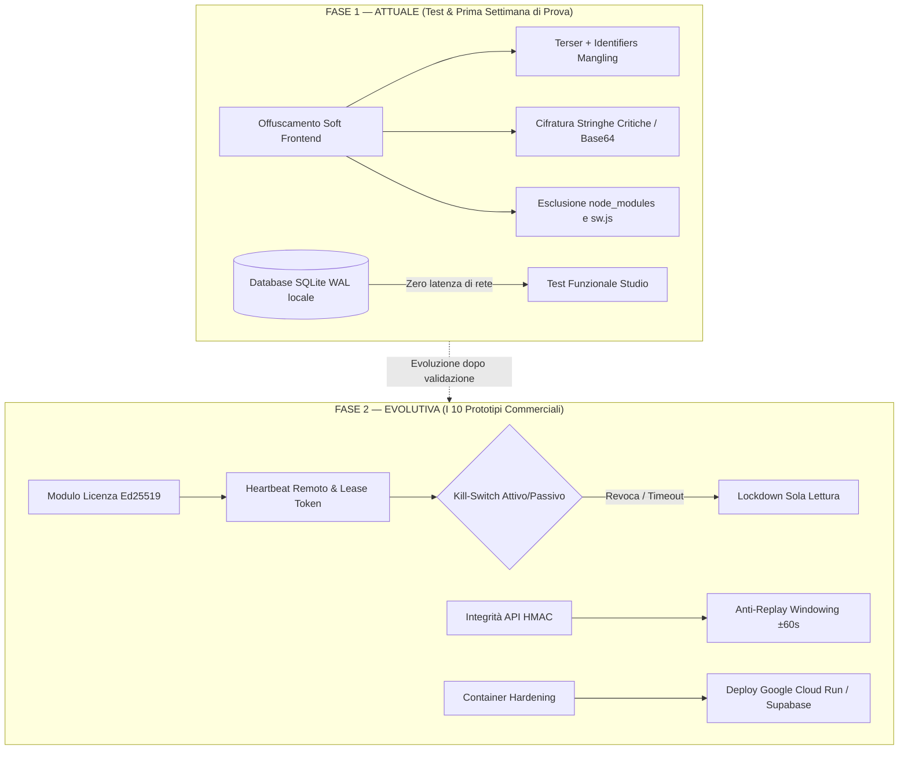

# Framework di Protezione & Security Hardening
**Progetto:** Atelier Élan — PWA Pilates & Danza Sportiva  
**Branch:** `enterprise-security-hardening`  
**Collocazione:** `doc/Protezione.md` e Artifact di Riferimento Architetturale  
**Data:** 18 Novembre 2026  

---

## 1. Visione d'Insieme & Filosofia di Protezione

Questo documento definisce la strategia di protezione del software, modulata sulle reali esigenze del ciclo di vita dell'applicazione:
1. **Fase 1 (Attuale / Test & Settimana di Prova):** Protezione *leggera e non invasiva*. L'obiettivo primario è preservare al 100% l'esperienza utente, garantire i 60fps su dispositivi mobile, azzerare l'overhead della CPU ed evitare qualsiasi blocco di debug durante le verifiche sul campo con gli utenti dello studio.
2. **Fase 2 (Evolutiva / Commerciale per i 10 Prototipi):** Protezione *commercial-grade enterprise*. Attivazione del controllo delle licenze crittografiche, heartbeat remoto con kill-switch, integrità API contro man-in-the-middle e hardening del container per cloud deployment.



---

## 2. FASE 1: Protezione Attuale (Soft & Zero-Impact)

### 2.1 Requisiti di Contesto
- **Profilo di Rischio Attuale:** Basso. L'applicazione non gestisce pagamenti diretti in-app con carte di credito né dati bancari; non richiede protezioni paranoiche che penalizzino i tempi di caricamento (LCP) o l'interattività (INP/FID).
- **Priorità Assoluta:** Fluidità PWA nativa (60fps), affidabilità offline tramite Service Worker (`sw.js`), avvio istantaneo da mobile e facilità di diagnostica.

### 2.2 Profilo di Offuscamento "Soft / Lightweight"
L'offuscamento viene applicato solo in fase di build (`npm run build`) tramite `javascript-obfuscator` / plugin Vite con profilo calibrato:

| Parametro | Valore Soft | Motivazione Tecnica |
| :--- | :--- | :--- |
| **Control Flow Flattening** | `false` | **Disattivato.** Il flattening moltiplica i salti ciclomatici, aumentando il consumo di batteria su mobile e rallentando i render di React 19. |
| **Dead Code Injection** | `false` | **Disattivato.** Evita l'aumento ingiustificato della dimensione del bundle. |
| **Anti-Debugging (`debugProtection`)** | `false` | **Disattivato.** I loop di debugger impedirebbero al team e ai tester di diagnosticare eventuali anomalie tramite console browser durante la settimana di prova. |
| **Self-Defending** | `false` | **Disattivato.** Evita conflitti con estensioni browser o strumenti di accessibilità. |
| **String Array Encoding** | `['base64']` | Cifra le stringhe applicative essenziali (endpoint, route interne, testi sensibili) senza l'overhead computazionale di RC4 a runtime. |
| **String Array Threshold** | `0.4` - `0.5` | Offusca solo una selezione di stringhe, mantenendo rapido il parsing iniziale. |
| **Identifier Mangling** | `mangled` | Rinominazione delle variabili e funzioni interne in nomi compatti di 1-2 caratteri (`a`, `b`, `c`), riducendo il peso del file e impedendo la lettura del codice. |
| **Scope di Esclusione** | `node_modules/**`, `public/sw.js` | Le librerie di terze parti (React, Tailwind, Lucide) e il Service Worker vengono compilati con minificazione standard Esbuild/Terser, garantendo massima stabilità. |

### 2.3 Risultato Atteso Fase 1
- **Dimensione Bundle:** Incremento inferiore al **5-10%** rispetto alla build standard.
- **Prestazioni:** Zero ritardi di rendering, avvio istantaneo della PWA.
- **Protezione Intellettuale:** Il codice sorgente business logic di Atelier Élan non è leggibile in chiaro (nessun identificatore di funzione o variabile parlante, nessuna logica immediatamente interpretabile).

---

## 3. FASE 2: Template di Protezione Commerciale (I 10 Prototipi)

> [!NOTE]
> Questa sezione rappresenta il **template architetturale riutilizzabile** da attivare al momento del rilascio commerciale per i 10 clienti/prototipi.

### 3.1 Modulo di Licenza Crittografica (Ed25519)
- **Crittografia Asimmetrica:** La software house detiene la *Chiave Privata* con cui firma digitalmente le licenze dei singoli studi. Il gestionale include esclusivamente la *Chiave Pubblica* nel backend.
- **Nessuna Possibilità di Forgiatura:** Senza la chiave privata è matematicamente impossibile estendere una scadenza o modificare i limiti della licenza.
- **Payload Licenza (`data/license.lic`):**
  ```json
  {
    "licenseId": "ELAN-2026-CLIENT-001",
    "customer": "Nome Studio / Palestra",
    "issuedAt": "2026-03-01T00:00:00Z",
    "expiresAt": "2027-03-01T00:00:00Z",
    "gracePeriodDays": 14,
    "limits": {
      "maxStudents": 300,
      "maxTeachers": 10,
      "features": ["pilates", "dance", "fiscalExport", "whatsapp"]
    }
  }
  ```

### 3.2 Validazione Remota & Heartbeat Daemon
- **Heartbeat Periodico:** Ogni 12/24 ore il backend invia un segnale di check-in al server di licensing centrale (`POST https://licensing.atelierelan.com/v1/heartbeat`).
- **Tolleranza Offline:** Il sistema ammette fino a **7 o 14 giorni di assenza di connessione internet** dello studio prima di attivare avvisi di blocco.

### 3.3 Architettura Kill-Switch (Revoca Remota)
In caso di recesso, mancato pagamento o violazione contrattuale:
1. **Comando di Revoca:** Il licensing server risponde all'heartbeat con `STATUS: REVOKED`.
2. **Lockdown Sola Lettura:** Il backend commuta il database in modalità read-only per non corrompere né cancellare i dati dello studio (rispetto della privacy e tutela legale).
3. **Blocco Operativo UI:** Disconnessione delle sessioni attive e visualizzazione a schermo di un banner di licenza sospesa con contatti amministrativi.

### 3.4 Integrità API (HMAC-SHA256 & Replay Protection)
- Tutte le chiamate critiche del client vengono firmate con header:
  - `X-Timestamp`: Unix epoch (finestra di validità ±60 secondi).
  - `X-Nonce`: Identificativo casuale monouso (UUIDv4).
  - `X-Signature`: `HMAC-SHA256(secret, method + path + timestamp + nonce + body)`.
- Il server blocca immediatamente le richieste ritrasmesse (replay attack) e quelle con timestamp scaduto.

### 3.5 Container Hardening & Google Cloud Run
- **Dockerfile Multi-Stage** su base `alpine`/`distroless`.
- Esecuzione strictly **non-root** (`USER node`).
- Filesystem container impostato in **Read-Only** (`--read-only`), con mount persistente dedicato per i dati.
- Segreti gestiti interamente via **Google Cloud Secret Manager**.

---

## 4. Matrice Decisionale di Attivazione

| Componente di Sicurezza | Stato Fase 1 (Test / Prova) | Stato Fase 2 (10 Prototipi) | Trigger di Passaggio |
| :--- | :--- | :--- | :--- |
| **Offuscamento Frontend** | **Soft** (Mangling + Base64 light) | **Hardened** (String RC4 + Self-defending) | Rilascio codice a clienti terzi non fidati |
| **Database** | **SQLite WAL Locale** | **Supabase / PostgreSQL Gestito** | Fine settimana di test / Requisito multi-device cloud concorrente |
| **Licenza Crittografica** | Disattivata | Attiva (Verifica asimmetrica Ed25519) | Consegna licenze commerciali ai prototipi |
| **Heartbeat & Kill-Switch** | Disattivato | Attivo con tolleranza 7-14 gg | Necessità di enforcement contrattuale/canone |
| **Firma API HMAC** | Disattivata | Attiva sugli endpoint sensibili | Esposizione API pubblica su dominio custom |
| **Cloud Run Hardening** | Standard Docker | Multi-stage non-root + Secret Manager | Deploy infrastrutturale su GCP per la produzione |

---

## 5. Note Operative per il Team
- Questo documento costituisce il riferimento ufficiale per ogni implementazione di sicurezza presente e futura.
- Per la settimana di prova, il focus operativo rimane concentrato sulla stabilità funzionale, la facilità d'uso per lo studio e la verifica della persistenza del database.
